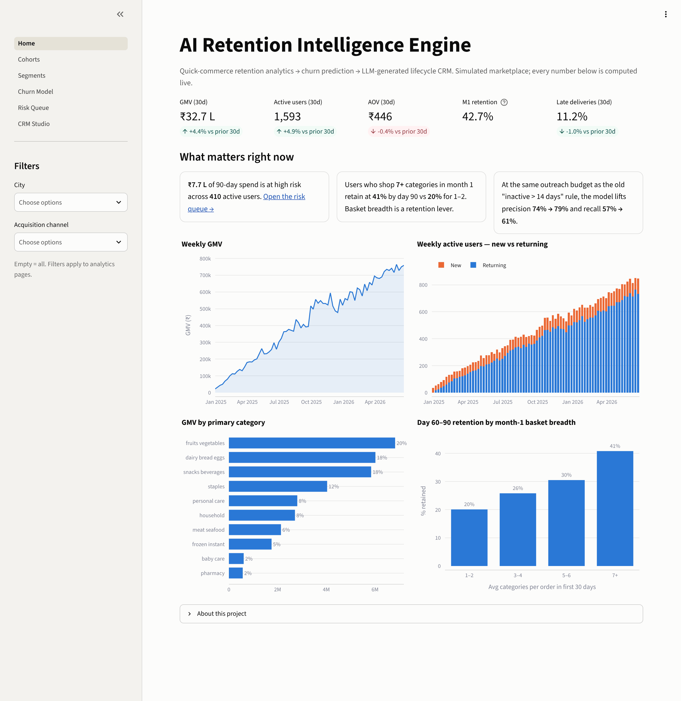
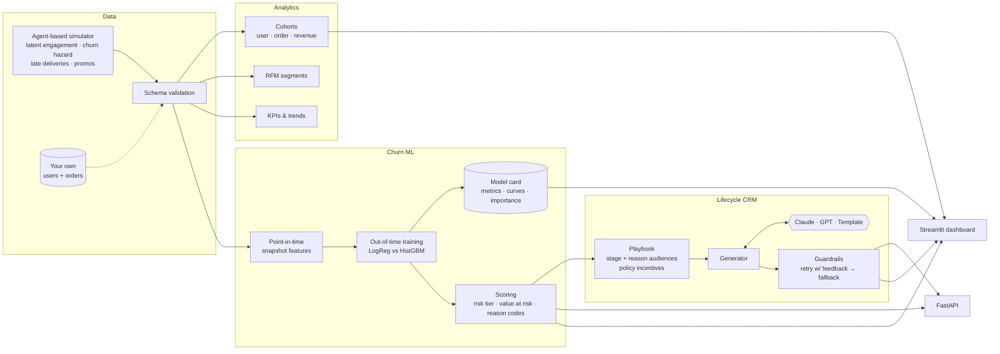
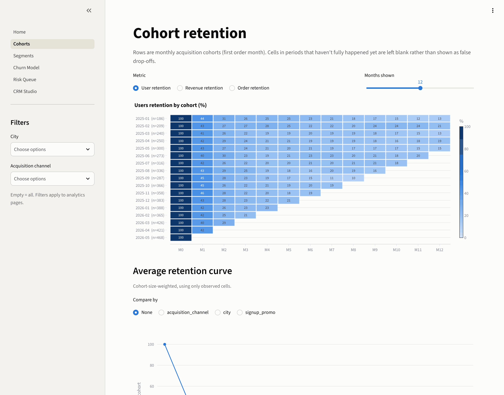
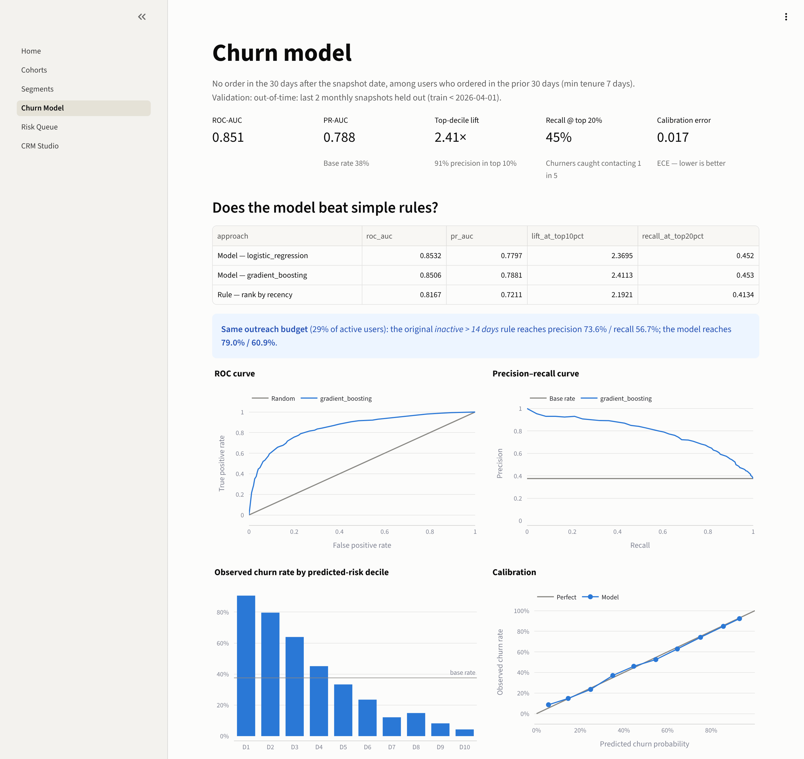
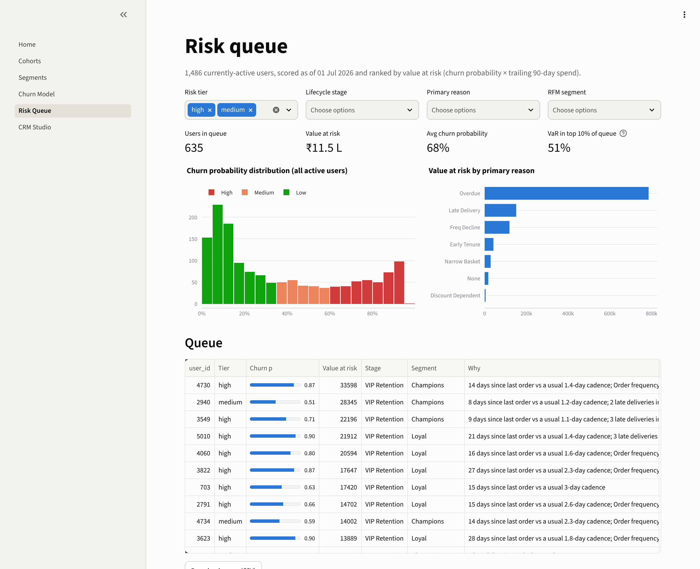
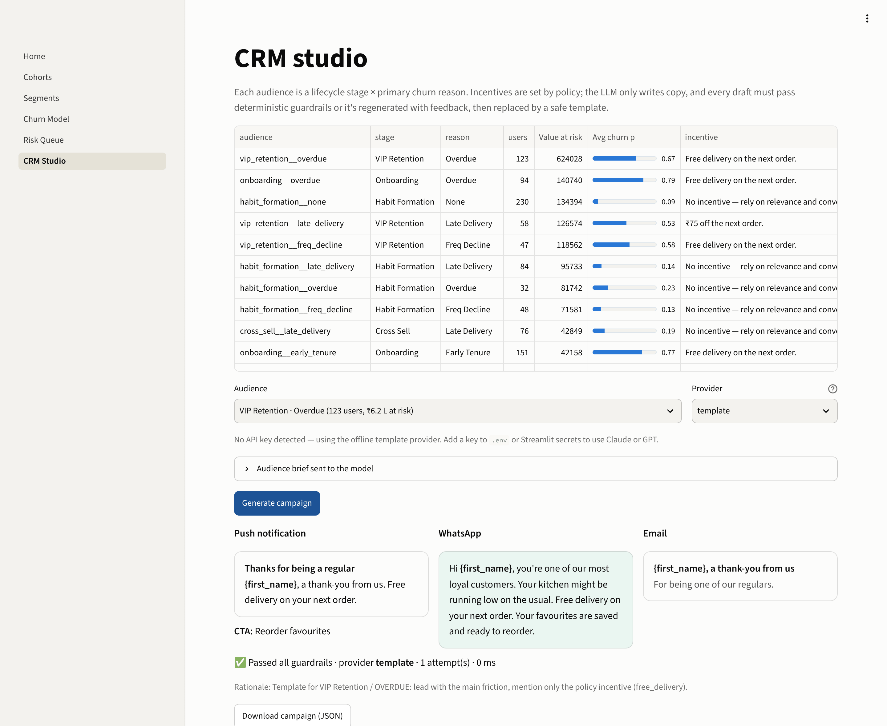

<div align="center">

# AI Retention Intelligence Engine

**Cohort analytics → ML churn prediction → LLM-generated lifecycle CRM, for a 10-minute grocery app.**

[](https://github.com/divs1311/ai-retention-engine/actions/workflows/ci.yml)


[](https://github.com/astral-sh/ruff)



</div>

---

## The problem

Quick-commerce apps lose most new users within a month: in this marketplace only **~43% of a cohort orders again in month 2**, and ~20% are still around by month 6. Retention teams usually respond with a blunt rule ("anyone inactive for 14 days gets a coupon"), which wastes discounts on people who were coming back anyway and misses the regulars who are quietly slipping away.

This project builds the system a growth team actually needs:

1. **Understand retention.** Censoring-aware cohort curves, revenue retention, RFM segments, and the behaviours that predict stickiness.
2. **Predict who will churn, and why.** A leakage-safe ML model scores every active user, ranks them by *value at risk*, and attaches plain-English reason codes.
3. **Act on it safely.** Each (lifecycle stage × churn reason) audience gets push, WhatsApp and email copy from Claude or GPT. A policy layer decides the incentives, deterministic guardrails check every draft, and a template fallback means nothing unsafe ever ships.

## Results

All numbers are measured **out-of-time** (trained on earlier months, evaluated on the two most recent fully observed monthly snapshots) on the simulated marketplace: 6,000 users and ~75k orders over 18 months.

| Approach | ROC-AUC | PR-AUC | Lift @ top 10% | Recall @ top 20% |
|---|---:|---:|---:|---:|
| **Gradient boosting (selected)** | **0.851** | **0.788** | **2.41×** | **45%** |
| Logistic regression baseline | 0.853 | 0.780 | 2.37× | 45% |
| Rule: rank by days since last order | 0.817 | 0.721 | 2.19× | 41% |

* **vs. the original v0 rule.** At the *same outreach budget* as "inactive > 14 days" (29% of active users), the model raises **precision from 73.6% → 79.0%** and **recall from 56.7% → 60.9%**. That's fewer wasted incentives and more saved customers.
* **Calibrated.** Expected calibration error is 0.017, so a "0.7" really means ~70%. That matters because value-at-risk multiplies probability by spend.
* **Honest model selection.** A well-specified logistic regression almost ties gradient boosting. GBM wins narrowly on PR-AUC and calibration, and both are reported.
* **Insight that drives the playbook.** Users who shop **7+ categories in their first month retain at 41% by day 90, vs 20% for 1–2 categories.** That's why "cross-sell" is a lifecycle stage of its own.

> The marketplace is simulated (see [how](#the-data)), so treat these as evidence that the *methodology* works, not as industry benchmarks.

## Architecture



A deeper write-up of the design decisions is in [`docs/architecture.md`](docs/architecture.md), and the model is documented in [`docs/model_card.md`](docs/model_card.md).

## Quickstart

```bash
git clone https://github.com/divs1311/ai-retention-engine.git && cd ai-retention-engine
python -m venv .venv && source .venv/bin/activate
pip install -e ".[all]"

retention-engine run          # simulate → train → score → campaigns (~10 s)
streamlit run app/Home.py     # dashboard on http://localhost:8501
retention-engine api          # REST API on http://localhost:8000/docs
```

Or with Docker (image ships with a ready-trained model):

```bash
docker compose up --build     # API on :8000, dashboard on :8501
```

**Using a real LLM.** Copy `.env.example` to `.env` and set `ANTHROPIC_API_KEY` and/or `OPENAI_API_KEY`. The provider is auto-detected; without a key, everything runs offline on the template provider.

## Dashboard

| | |
|---|---|
| **Cohorts.** Censoring-aware heatmaps for users, orders or revenue, plus weighted curves split by channel, city or promo. <br> | **Churn model.** The model card: rule baselines, ROC/PR, decile lift, calibration, permutation importance. <br> |
| **Risk queue.** Users ranked by value at risk, with reason codes, filters, CSV export and a per-user drill-down. <br> | **CRM studio.** Pick an audience and a provider, then generate and inspect channel previews and the guardrail report. <br> |

## CLI

```text
$ retention-engine --help
 generate    Simulate a quick-commerce marketplace (users + orders).
 kpis        Print headline KPIs.
 train       Train and evaluate the churn model (out-of-time validation).
 score       Score the active user base and write the prioritised risk queue.
 campaigns   Generate lifecycle CRM campaigns for each audience.
 run         Run the full pipeline: generate → train → score → campaigns.
 api         Serve the REST API (FastAPI + Uvicorn).
 dashboard   Launch the Streamlit dashboard.
```

## REST API

Interactive docs live at `/docs`. If `RE_API_KEY` is set, every `/v1` route requires an `X-API-Key` header.

| Method | Route | Purpose |
|---|---|---|
| `GET` | `/health` | Liveness + model version |
| `GET` | `/v1/model` | Model card (metrics, baselines, importances) |
| `GET` | `/v1/kpis`, `/v1/segments` | Headline KPIs, RFM segment summary |
| `GET` | `/v1/users/at-risk?tier=high&limit=50` | Value-at-risk queue |
| `GET` | `/v1/users/{id}/risk` | One user's score, tier, stage and reasons |
| `POST` | `/v1/score` | Score raw feature vectors (e.g. from a feature store) |
| `GET` | `/v1/audiences` | CRM audience briefs |
| `POST` | `/v1/campaigns/generate` | Generate a guardrailed campaign for an audience |

```bash
curl -s "localhost:8000/v1/users/at-risk?tier=high&limit=1" | jq
```
```json
[{
  "user_id": 4730, "churn_probability": 0.87, "risk_tier": "high", "value_at_risk": 33598.02,
  "rfm_segment": "Champions", "lifecycle_stage": "vip_retention",
  "reason_codes": "OVERDUE|FREQ_DECLINE|LATE_DELIVERY",
  "reason_text": "14 days since last order vs a usual 1.4-day cadence; Order frequency down ~67%; 3 late deliveries in the last 30 days"
}]
```

## How it works

### The data

The v0 generator drew each month's retention independently from a fixed curve, so no behaviour actually *predicted* churn. The new simulator is agent-based: every user carries latent **engagement** that evolves weekly. Late deliveries knock it down and good experiences nudge it up. Order frequency rises with engagement, while churn hazard falls with it and also depends on tenure (steep early drop-off), acquisition channel, promo-driven signup and basket breadth. Lapsed users occasionally come back. The result has the properties of a real quick-commerce dataset: realistic cohort curves, festive seasonality, an AOV around ₹450, and signals a model can learn without having them handed over.

Bring your own data by pointing `RE_DATA_DIR` at `users` / `orders` files (Parquet or CSV) that match [`data/schema.py`](src/retention_engine/data/schema.py). Validation reports exactly what's wrong.

### Churn model

* **Definition:** no order in the next 30 days, among users who ordered in the last 30 days and have at least 7 days of tenure.
* **Point-in-time features** (21 numeric + 3 categorical): recency, frequency and spend windows; **momentum** (last 30 days vs the prior 60); **cadence** and an **overdue ratio** (days since last order ÷ usual gap); late-delivery rate; discount dependence; basket breadth; channel and city.
* **No leakage:** features at a snapshot only see orders before it, and a test proves that tampering with future orders leaves them unchanged.
* **Out-of-time validation** on monthly snapshots, a logistic baseline vs `HistGradientBoostingClassifier`, selection on PR-AUC, then a refit on all labelled history.
* **Outputs:** calibrated probability, risk tier, value at risk (probability × trailing 90-day spend) and ranked **reason codes** (`OVERDUE`, `FREQ_DECLINE`, `LATE_DELIVERY`, `NARROW_BASKET`, `EARLY_TENURE`, `DISCOUNT_DEPENDENT`).

### LLM lifecycle CRM

* **Audiences, not individuals.** Copy is generated per *stage × reason* (e.g. *VIP retention · late delivery*) and personalised with `{first_name}` / `{top_category}` merge tokens at send time. LLM cost stays flat as the base grows, and every message can be reviewed before it goes out.
* **Policy decides incentives; the model only writes copy.** Low-risk users never get discounts (discount addiction is a real cost). VIPs hit by late deliveries get a ₹75 service-recovery credit rather than a coupon, and only lapsed users get money off.
* **Guardrails:** per-channel length limits, banned spam phrases, no ALL-CAPS, an emoji cap, an allow-list for merge tokens, and **offer consistency** (the copy may only mention the exact incentive the policy granted).
* **Failure handling:** if a draft violates a guardrail, the violations go back to the model as feedback and it retries. After that, a vetted template is used. Provider errors and timeouts fall back the same way. Responses are cached by provider, model, prompt version and brief.

## Project structure

```text
├── src/retention_engine/
│   ├── config.py            # typed settings, env-overridable (RE_*)
│   ├── data/                # simulator, schema contracts, IO
│   ├── analytics/           # cohorts, RFM, KPIs
│   ├── churn/               # features, model, evaluation, reason codes
│   ├── crm/                 # playbook, prompts, providers, guardrails, generator
│   ├── api/                 # FastAPI app + schemas
│   ├── pipeline.py          # orchestration shared by CLI / API / UI
│   └── cli.py               # Typer CLI
├── app/                     # Streamlit multi-page dashboard
├── tests/                   # 236 tests (unit, leakage, guardrails, API, CLI)
├── docs/                    # architecture, model card, screenshots
├── Dockerfile · docker-compose.yml · Makefile · .github/workflows/ci.yml
```

## Development

```bash
make dev        # install with dev tools + pre-commit hooks
make test       # pytest with coverage
make lint       # ruff lint + format check
make typecheck  # mypy
```

CI runs lint and type checks, tests on Python 3.10–3.13, a lowest-supported-dependencies job, an end-to-end pipeline smoke test (uploading the model card as an artifact), and a Docker build with a `/health` probe.

## Configuration

Every setting can be overridden with an environment variable. See [`.env.example`](.env.example). Some examples:

| Variable | Default | Meaning |
|---|---|---|
| `RE_SIMULATION__N_USERS` | `6000` | Simulated users |
| `RE_CHURN__HORIZON_DAYS` | `30` | Churn label window |
| `RE_CHURN__HIGH_RISK_THRESHOLD` | `0.6` | High-risk tier cut-off |
| `RE_LLM__PROVIDER` | `auto` | `auto` · `anthropic` · `openai` · `template` |
| `RE_LLM__ANTHROPIC_MODEL` / `RE_LLM__OPENAI_MODEL` | `claude-haiku-5-5` / `gpt-5.4-mini` | Model IDs |
| `RE_API_KEY` | – | Enables API-key auth |

## Deploying the demo

**Streamlit Community Cloud:** create an app from this repo with entrypoint `app/Home.py` (it installs from `requirements.txt`). Optionally add `ANTHROPIC_API_KEY` under *Secrets*. The first load simulates the data and trains the model (~20 s), and later loads are cached.

## Roadmap

- [ ] Uplift modelling: target users whose churn the campaign *changes*, not just high-risk users
- [ ] Holdout-based campaign measurement (treatment vs control) fed back into the playbook
- [ ] Survival model (time-to-churn) alongside the 30-day classifier
- [ ] Drift monitoring on feature distributions between snapshots

## Author

**Divyanshu** · [GitHub @divs1311](https://github.com/divs1311)

Licensed under the [MIT License](LICENSE).
